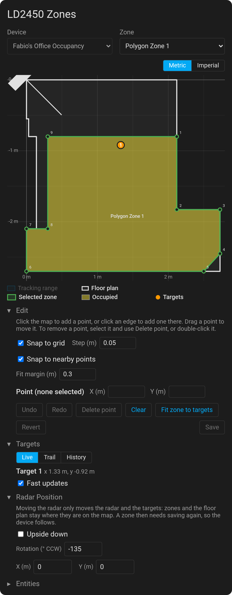

# LD2450 Zone Card

A Home Assistant dashboard card to draw polygon zones for [ESPHome](https://esphome.io/) LD2450 radars. Zones are
evaluated on the device.

> Requires ESPHome 2026.11 or later (beta or final), for the polygon zones
> ([esphome/esphome#20154](https://github.com/esphome/esphome/pull/20154)) and the target `xy` text sensors
> ([esphome/esphome#21416](https://github.com/esphome/esphome/pull/21416)). **Fast updates** also need
> [esphome/esphome#22285](https://github.com/esphome/esphome/pull/22285), which isn't merged yet.



## Features

- **Automatic discovery** of ESPHome LD2450 devices, their zones, presence sensors and target sensors, named after
  your Home Assistant _Entity ID format_. Anything it can't find can be set in the card config (see
  [Configuration](#configuration)).
- **Draw zones on the map:** add, insert, drag and delete points (touch works too), or type coordinates. Snap to a
  grid and to the points of the floor plan and other zones. Undo and redo.
- **Safe saving:** zones are checked (the firmware takes 3 to 23 points, and points outside the tracking range are
  warned about), written to the device, and confirmed when the device reports them back. If the save fails, your
  drawing is kept to fix and save again.
- **Live targets,** and with the optional `xy_unfiltered` button (see
  [ESPHome configuration](#esphome-configuration)), **Fast updates:** every position the radar reports, instead of
  one a second, while the card is visible.
- **Trail and History:** see where people actually walk, sit or stand, from the positions seen since you opened
  the Trail view (which you can pause), or from what Home Assistant recorded in a period (the last 7,000 positions;
  History needs the recorder). Positions are colored by age, from dark purple for the oldest to yellow for the
  newest, with a scale showing the times. **Fit zone to targets** turns the targets on the map into a zone around
  them, keeping a margin.
- **Floor plan and radar position:** draw the room's outline, and place the radar in it (upside down, rotation, X/Y).
  Only the radar and the targets move with it. The device keeps zones relative to the radar, so after moving it, save
  the zones again. Shared by all users; only administrators can change them.
- **Settings:** units, map toggles, snapping, the selected device and zone, and which sections are open are per user,
  so the card comes back as you left it. Radar positions and floor plans are shared (Home Assistant 2025.12 or
  later).
- **Visual editor** for every option.

## Installation

### Marketplace

On Home Assistant 2026.11 or later, open the repository in your Home Assistant's Marketplace, which offers to add it
first if it isn't there yet:

[](https://my.home-assistant.io/redirect/marketplace_repository/?owner=fornellas&repository=ld2450-zone-card&category=plugin)

### HACS

1. Open HACS, then the ⋮ menu → **Custom repositories**.
2. Add `https://github.com/fornellas/ld2450-zone-card` with type **Dashboard**.
3. Search for **LD2450 Zone Card**, download it, and reload the browser.

### Manual

1. Download `ld2450-zone-card.js` from the [latest release](https://github.com/fornellas/ld2450-zone-card/releases).
2. Copy it to `/config/www/` in Home Assistant.
3. In **Settings → Dashboards → ⋮ → Resources**, add `/local/ld2450-zone-card.js` as a **JavaScript module**.
4. Reload the browser.

## Usage

Add the card to a dashboard from the card picker (**LD2450 Zone Card**), or with YAML:

```yaml
type: custom:ld2450-zone-card
```

### ESPHome configuration

A full example, with two zones and three targets:

```yaml
uart:
  id: uart_ld2450
  # The LD2450's TX goes to the ESP's RX, and its RX to the ESP's TX. Use your board's pins.
  tx_pin: GPIO17
  rx_pin: GPIO16
  baud_rate: 256000
  parity: NONE
  stop_bits: 1

ld2450:
  id: ld2450_radar
  uart_id: uart_ld2450

# One text entity per zone, holding its polygon. The card draws and saves them.
text:
  - platform: ld2450
    ld2450_id: ld2450_radar
    polygon_zones:
      - id: couch_zone
        name: Couch Zone Polygon
      - id: desk_zone
        name: Desk Zone Polygon

# One presence sensor per zone. "<zone name> Occupied" pairs with its zone in the card automatically.
binary_sensor:
  - platform: ld2450
    ld2450_id: ld2450_radar
    polygon_zones:
      - polygon_zone_id: couch_zone
        name: Couch Occupied
      - polygon_zone_id: desk_zone
        name: Desk Occupied

# Target positions, drawn live on the card's map, each as "x,y" in mm (or "NA" without a target), with x and y from the
# same radar frame. Keep their default icon, so the card finds them, and name them "Target N XY". By default, a
# position is published at most once per `throttle` (1 s): see the optional xy_unfiltered button below for more.
text_sensor:
  - platform: ld2450
    ld2450_id: ld2450_radar
    target_1:
      xy:
        name: Target-1 XY
    target_2:
      xy:
        name: Target-2 XY
    target_3:
      xy:
        name: Target-3 XY

# Optional, for Fast updates. It needs esphome/esphome#22285, which isn't merged yet: until it is, ESPHome fails
# to compile this block, so leave it out, or build ESPHome from that pull request. Pressing this button makes the xy
# text sensors publish every position the radar reports (up to 10 per second) for the next 10 seconds, ignoring their
# filters. The card presses it every 3 seconds while it's visible and its Fast updates switch is on, for a smooth map
# and a trail with every position. When no card is open, the filters apply again by themselves, so Home Assistant only
# gets the extra updates while someone looks. Keep its default icon, so the card finds it.
button:
  - platform: ld2450
    ld2450_id: ld2450_radar
    xy_unfiltered:
      name: XY Unfiltered
```

Each press is a state change in Home Assistant, as for any button: you may want to
[exclude](https://www.home-assistant.io/integrations/recorder/#configure-filter) the button from the recorder.

Name each presence sensor `<zone name> Occupied` (for example `Couch` and `Couch Occupied`) and the card pairs them
automatically. Other names are paired by the words they share, and a zone that matches more than one sensor equally
well is left for you to pair in the [configuration](#configuration).

Zones are checked on the device in the radar's own coordinates, and the `xy` sensors publish the same raw
coordinates, so the card draws both on the same map. For a radar mounted upside down, use the card's **Upside down**
option, not ESPHome filters.

### Configuration

Auto-discovery depends on the default configuration. If you change anything, you'll need to manually specify the
entities. Discovery relies on these defaults:

- **Target `xy` text sensors:** `sensor` entities on the same device as the zones (Home Assistant shows ESPHome text
  sensors as sensors), with the icon `mdi:crosshairs-gps`, and a state that's `x,y` in mm, `NA`, `unknown` or
  `unavailable`. Targets are numbered by the number in their names (for example `Target-1 XY`), or by name order.
- **Presence sensors:** `binary_sensor` entities on the same device as the zones, with `device_class: occupancy` and
  no icon, paired with their zones by name (see above).
- **`xy_unfiltered` button:** the only `button` entity on the same device as the zones with the icon `mdi:filter-off`.
  It's optional: without it the card works as before.

Changing an icon or device class in your ESPHome YAML or in Home Assistant hides that entity from discovery. Name it in
the `targets:` (`xy` text sensors), `xy_unfiltered:` (button) or `zones:` (presence sensors) option instead.

Every option can be set in the card's visual editor, or in YAML. They're all optional, and override automatic
discovery:

```yaml
type: custom:ld2450-zone-card
title: Living room radar # card title
device_id: 0123456789abcdef # only show this device
targets: # the target xy text sensors
  - xy: sensor.living_room_target_1_xy
xy_unfiltered: button.living_room_xy_unfiltered # the button that turns the xy filters off while the card is visible
zones: # pair a zone with its presence sensor
  - polygon: text.living_room_couch_zone
    presence: binary_sensor.living_room_couch_occupied
```

## Development

```sh
npm install
npm run watch   # rebuilds dist/ld2450-zone-card.js on changes
npm run check   # typecheck, format check, tests, build, and a check that docs/screenshot.png is current (needs Chrome)
npm run screenshot   # rebuilds docs/screenshot.png from the current code (set CHROME_PATH if Chrome isn't found)
```

To try a build, copy `dist/ld2450-zone-card.js` to `/config/www/` and add the resource as in the manual installation.
Bump `?v=` in the resource URL or clear the browser cache to load a new build.

Releases: push a tag such as `v0.1.0` (`git tag v0.1.0 && git push origin v0.1.0`). The release workflow checks and
builds the card, then creates the GitHub release with `ld2450-zone-card.js` attached, which HACS installs. Tags with a
`-`, such as `v0.1.0-beta.1`, become pre-releases.
